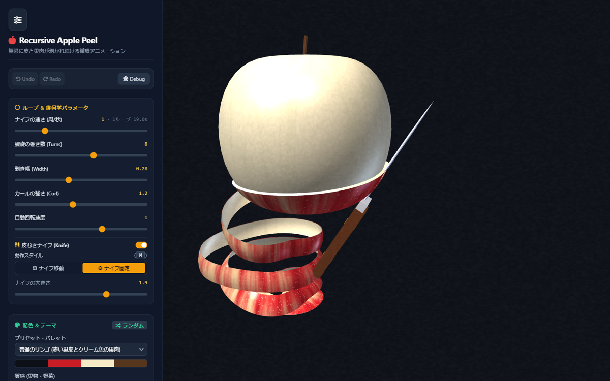
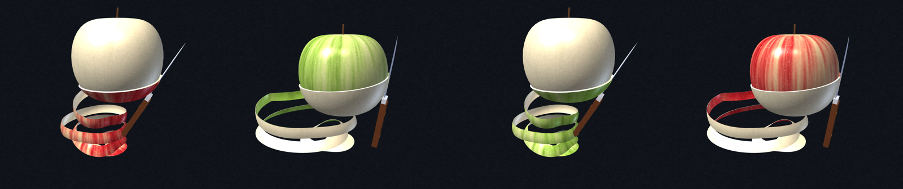

# apple-peeling-loop

[](https://p5js.org/)
[](https://tonejs.github.io/)
[](https://developer.mozilla.org/docs/Web/API/WebCodecs_API)
[](https://github.com/Vanilagy/mp4-muxer)
[](https://tailwindcss.com/)
[](#4-実行方法)
[](https://github.com/nullhodo/apple-peeling-loop/commits/main)

りんごの皮と果肉が、切れ目なく無限に剥かれ続ける p5.js (WebGL) のループアニメーション





## 目次

1. [概要](#1-概要)
2. [仕組み](#2-仕組み)
3. [構造](#3-構造)
4. [実行方法](#4-実行方法)
5. [使い方](#5-使い方)
6. [参考資料](#6-参考資料)

## 1. 概要

外皮の剥離 (前半) と果肉の剥離 (後半) を交互に繰り返し、剥いた厚みに釣り合うだけりんごを少しずつ拡大することで、切れ目のない無限ループとして剥かれ続ける様子を描く。描いたループは、コマ落ちのない mp4 としてそのまま書き出せる

### 1-1. 主な機能

| 分類               | 内容                                                                                                                                                               |
| ------------------ | ------------------------------------------------------------------------------------------------------------------------------------------------------------------ |
| 剥離               | 巻き数・剥き幅・カールの強さ・ナイフの速さ・自転の速さを調整できる。ループ周期は巻き数と速さから自動で決まり、自転は1ループあたり整数回に丸める                    |
| 垂れ下がる皮       | りんごの下まで垂れてから、果皮を外側にして巻く。元の緯度の測地曲率から巻きの半径と開き角を決めるため、赤道付近は円筒状、ヘタ側とお尻側は逆向きに開いた渦巻きになる |
| ナイフ             | ナイフがりんごの周りを巡る `moving` と、ナイフを固定してりんご側が回転・昇降する `fixed` (既定) を切り替えられる                                                   |
| 配色               | プリセットパレット、単色からのテーマ自動生成、部位ごとのカラーピッカー                                                                                             |
| 外皮の交互切り替え | 2つ目の外皮の色を有効にすると、赤りんご → 果肉 → 青りんご → 果肉 → 赤りんご のように1ループごとに外皮が切り替わり、2ループで元に戻る                               |
| 質感               | りんご・みかん・梨・柿・じゃがいも・キウイの果皮と果肉の模様をノイズから生成し、艶も変える。フィルムグレインも重ねられる                                           |
| サウンド           | ピンクノイズをバンドパスに通した ASMR 風の皮むき音                                                                                                                 |
| 編集               | Undo / Redo (最大 30 履歴)、カテゴリを選んでのランダム化と周期的な自動変更、デバッグ HUD                                                                           |
| 書き出し           | 2560x2560 の PNG、60fps / 16Mbps の mp4 動画 (H.264、非対応環境では VP9 / AV1)、設定 JSON の保存と復元                                                             |

## 2. 仕組み

ビルドツールを使わない静的 HTML で、ライブラリはすべて CDN から読み込む

- 描画: p5.js 1.9.4 (WebGL)
- オーディオ: Tone.js 14.8.49
- 動画書き出し: WebCodecs (VideoEncoder / AudioEncoder) と mp4-muxer 5.2.2
- UI: Tailwind CSS (CDN) / Font Awesome 6.4.0

### 2-1. 剥ける表現

りんごの表面は、ヘタからお尻まで巻きつく1本の螺旋の帯メッシュでできている。ナイフが通った部分は皮の厚みぶん内側に描き直し、テクスチャを果皮から果肉に替える。切り離された皮は別のリボン状のメッシュになり、垂れ下がって巻く

前半で果皮を、後半で果肉を同じように剥くと、剥いた分だけ小さくなったりんごが元の大きさまで拡大されて、最初の状態に戻る

### 2-2. 動画の書き出し

| 録画の種類       | 映像                                                                                                                            | 音声                                                     |
| ---------------- | ------------------------------------------------------------------------------------------------------------------------------- | -------------------------------------------------------- |
| 手動録画         | 描画のたびに実時間のタイムスタンプでエンコードする                                                                              | Tone.js の出力をそのまま録る                             |
| 指定ループ数録画 | 描画ループを止め、1/60 秒刻みの時刻で描いてはエンコードする。コマ落ちがなく、剥き始める前の状態から録るため最初と最後がつながる | 各フレームの剥き状態から Tone.Offline で同じ音を生成する |

効果音をオフにしていると、音声なしの mp4 になる

## 3. 構造

```text
apple-peeling-loop/
├── index.html
├── README.md
│
├── css/
│   └── styles.css
│
├── docs/                   - README 用の画像
│   ├── screenshot.png
│   └── loop.png
│
└── js/                     - スケッチ本体 (index.html の script タグで読み込む)
    ├── state.js            - パラメータ初期値とグローバル状態
    ├── sketch.js           - p5.js の初期化とメイン描画ループ
    ├── renderer.js         - 剥離タイムラインの算出と、りんご・垂れ下がる皮・ナイフの描画
    ├── geometry.js         - りんごの表面形状と螺旋帯メッシュの計算
    ├── textures.js         - 果物・野菜ごとの果皮・果肉とグレインの生成
    ├── palettes.js         - プリセットパレットと単色テーマの生成
    ├── audio.js            - 皮むき音の生成と、録画用のオフライン生成
    ├── recorder.js         - mp4 動画の録画 (WebCodecs + mp4-muxer)
    ├── export.js           - 高解像度 PNG の書き出しと設定 JSON の保存・復元
    ├── history.js          - Undo / Redo の履歴
    ├── randomizer.js       - パラメータのランダム化と周期的な自動変更
    ├── ui.js               - UI イベント・コントロールの同期・ショートカット
    └── utils.js            - 日時の整形と色変換
```

## 4. 実行方法

ビルドは不要。ブラウザで `index.html` を直接開くか、任意の静的サーバーで配信する

| コマンド                      | 実行内容                                              |
| ----------------------------- | ----------------------------------------------------- |
| `python3 -m http.server 8000` | Python の簡易サーバーを起動 (`http://localhost:8000`) |
| `npx serve .`                 | Node.js の `serve` で起動                             |

mp4 の書き出しには WebCodecs が必要なため、Chrome / Edge などの Chromium 系ブラウザを推奨

## 5. 使い方

### 5-1. キーボードショートカット

| キー                      | 動作                                                                      |
| ------------------------- | ------------------------------------------------------------------------- |
| `U` / `Tab`               | コントロールパネルの開閉                                                  |
| `M`                       | ナイフ移動 / ナイフ固定の切り替え                                         |
| `R` / `S`                 | 録画の開始 / 停止 (指定ループ数録画中の `S` は、そこまでで打ち切って保存) |
| `D`                       | デバッグ HUD の表示切り替え                                               |
| `Ctrl+Z`                  | 元に戻す                                                                  |
| `Ctrl+Y` / `Ctrl+Shift+Z` | やり直す                                                                  |

### 5-2. 外皮が交互に切り替わるループ動画を作る

1. 配色の「2つ目の外皮 (交互)」にチェックを入れ、色を選ぶ
2. 録画の「Loop録画」を押す

外皮が2ループで元に戻るため、ループ数は2の倍数に切り上げられる。書き出した mp4 と同名の設定 JSON も保存されるので、あとから同じ動画を作り直せる

## 6. 参考資料

- [リンゴをクルクル回してむいた皮のカタチ - 三谷純](https://junmitani.hatenablog.com/entry/20150728)
  - 包丁で回しむきしたリンゴの皮を平らに置くと、逆向きの渦2つが中央でつながった S 字になることを、多面体の展開図で確かめた記事
  - 皮の帯の面内の曲がりは赤道付近でゼロになり、ヘタ側とお尻側で向きが反転する。垂れ下がる皮の巻き方を考える根拠にしている
- [File:Apple_peal.jpg - Wikimedia Commons](https://commons.wikimedia.org/wiki/File:Apple_peal.jpg)
  - ナイフで剥いた皮がりんごの上をループする写真。果皮が巻きの外側、果肉が内側に来ることの根拠にしている
- [Bartholdi & Henriques, Orange peels and Fresnel integrals (arXiv:1202.3033)](https://arxiv.org/abs/1202.3033)
  - 細い螺旋状に剥いた球の皮を平らにすると、両端が渦を巻くオイラー螺旋に近づくことを示した論文
